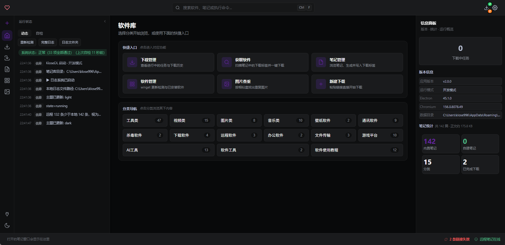
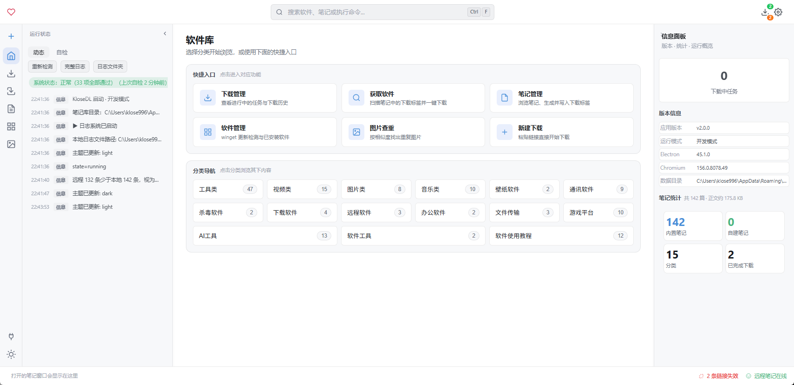

# KloseDL

Windows 上的下载器：直链批量、m3u8 双引擎，顺带一个 Markdown 笔记库。
免费使用，功能对所有用户一致。

亮色主题

## 下载

**最新版**：[Releases](https://github.com/Klose2/KloseDL-releases/releases/latest)

- 系统：Windows 10 / 11，64 位
- 安装包：`KloseDL-Setup-x.y.z.exe`，约 240 MB
- 体积大是因为**工具随包**：aria2-next、N_m3u8DL-RE、ffmpeg / ffprobe、yt-dlp 都在里面，装完即用，不需要你再单独配环境

> **安装时 Windows 提示"已保护你的电脑"？**
> 安装包没有购买代码签名证书，SmartScreen 会拦一次。点「更多信息」→「仍要运行」即可，
> 校验和可以在对应 Release 的说明里核对。

## 能干什么

- **直链批量下载**：走 aria2 常驻进程，起跑连接数按域名记台账自动调（挨 429 对折、干净跑完再加），
  断了能续，同一份文件重复下载会先校验 SHA256 秒传
- **m3u8 / HLS**：默认自动选引擎——明文、AES-128、fMP4 单轨走内置引擎（支持真暂停、恢复只补缺片、
  首片慢时自动降并发）；DRM、BYTERANGE、主清单带独立音轨的走 N_m3u8DL-RE
- **完整性**：GitHub 源的安装包按官方 digest 校验；自己下完的文件可以算 SHA256 存进笔记
- **笔记库**：Markdown 笔记带标签、分类、链接体检，可以挂一个远程仓库做同步
- **图片查重**：按相似度找出重复/近似图片
- **日志**：跑的时候干了什么、哪一步失败、为什么失败，都在首页日志里，不是只给你一句"下载失败"

## 常见问题

**装完打不开 / 被杀毒软件拦了？**
安装包未签名，部分安全软件会误报。加信任后重装即可；仍不行请提 issue 并附上首页日志。

**下载的数据存在哪？**
`%APPDATA%\Klose-downloader`（设置、日志、失败记录）。下载文件默认在「下载目录」，可在设置里改。
卸载不会自动删这个目录。

**为什么 m3u8 有时会切到外部工具？**
内置引擎覆盖不了 DRM、独立音轨、BYTERANGE 这些形态时会自动回退到 N_m3u8DL-RE，
日志里会写清楚切了以及为什么。

**支持断点续传吗？**
直链支持；m3u8 在内置引擎下是真暂停（落盘状态、恢复只补缺片），用外部工具时按工具自身能力来。

## 支持

如果它帮你省了点时间，可以在这里请我喝杯咖啡：

https://afdian.com/a/KloseDL

## 说明

- 免费使用，按现状提供（AS IS），不提供任何担保
- 没有埋点，不上报使用数据；下载与笔记都在你本机。
  （会联网的地方只有：检查更新、拉软件图标、远程笔记仓库——都是你自己触发的）
- 随包工具的许可证见各自项目主页（aria2-next / N_m3u8DL-RE / FFmpeg / yt-dlp）

技术细节（给好奇的人）

- Electron 45 + TypeScript，主进程 `main/`、界面 `renderer/`、可单测的纯函数在 `shared/`
- 分片调度在 `main/m3u8-*`，传输统一走 aria2 常驻（不自研分块）
- 日志三处统一脱敏（`main/log-redact.ts` 是唯一出口），界面只转发「动作与异常」
- 每个修复都在 `docs/adr/` 里有一张决策卡，踩过的坑在 `docs/lessons/`

